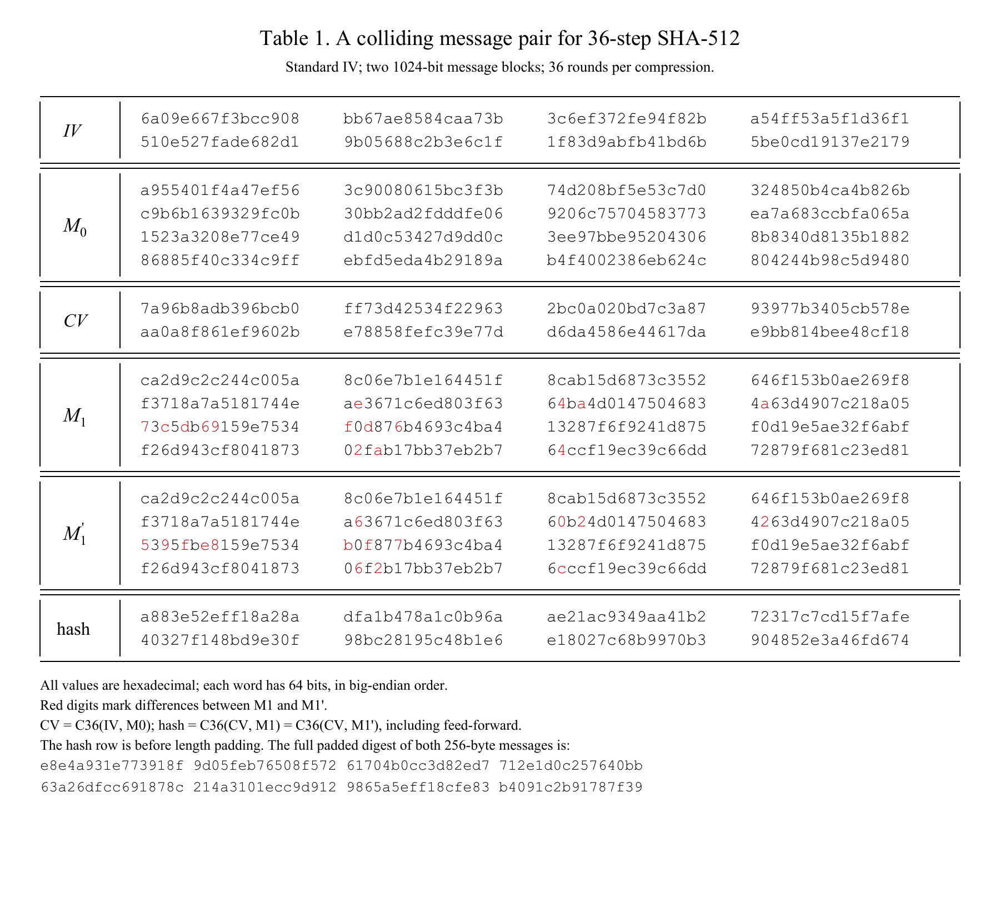

# A Collision for 36-Round SHA-512

We have found a collision for **SHA-512 reduced to 36 rounds**. Two distinct 256-byte messages, starting from the standard SHA-512 initial value, produce the same full 512-bit output. Their digests also remain equal after standard SHA-512 length padding.

Each compression in this reduced-round variant executes rounds **0–35**, including the common first block and the padding block. The standard message expansion, round constants, and eight-word feed-forward are retained.

The messages share a first block, `M0`, and have different second blocks, `M1` and `M1'`:

```text
CV = C36(IV, M0)
C36(CV, M1) = C36(CV, M1'), with M1 != M1'
```

The table below gives the standard IV, the message blocks, the intermediate CV, and the common output. Red hexadecimal digits identify differences between the two second blocks. The `hash` row is the two-block feed-forward output before padding; the common padded digest is shown below the table.


